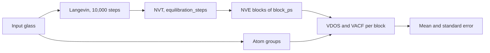
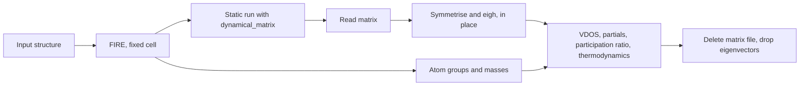

# Vibrational Density of States

The vibrational density of states (VDOS) $g(\nu)$ gives the distribution of vibrational frequencies of a structure.
`vdos_simulation` computes it from the atomic velocities of a microcanonical (NVE) MD run, through the velocity
autocorrelation function (VACF), in total and per atom group (element, oxygen class, $\mathrm{Q}^n$ species). The MD
includes every anharmonic effect of the potential, so the result describes the system at the simulation temperature.
The [harmonic route](#harmonic-route), `harmonic_vdos_simulation`, works from the dynamical matrix of the minimised
structure instead. It describes the 0 K inherent structure, has no statistical noise and resolves every normal mode,
but it holds dense $3N \times 3N$ matrices in memory, so it is limited to `max_atoms` (10,000 by default). Use the VACF
route for the glass at temperature and for large boxes, and the harmonic route for mode-resolved quantities of a
structure of moderate size.

The [VDOS tutorial](../../notebooks/VDOSTutorial.ipynb) runs the VACF route on a 300-atom $\mathrm{SiO_2}$ glass,
compares the result with the silica VDOS of Fossati et al. (2021), and runs the harmonic route on the same glass.

Frequencies are ordinary frequencies in THz (not angular frequencies) throughout.

---

## Theory

This section applies to any VDOS, whichever route produced it.

### Frequency units

`convert_frequency(values, from_unit, to_unit)` converts scalars or arrays between four units, through THz. Negative
values keep their sign.

| Unit | Name in code | Value of 1 THz |
|---|---|---|
| THz | `"THz"` | 1 |
| $\mathrm{cm^{-1}}$ | `"cm-1"` | 33.3564 |
| meV | `"meV"` | 4.13567 |
| rad/ps | `"rad/ps"` | $2\pi$ = 6.28319 |

A frequency corresponds to a temperature $h\nu / k_B$: 1 THz is 48 K.

### Reduced VDOS, boson peak and Debye level

An isotropic elastic continuum with bulk modulus $B$, shear modulus $G$ and mass density $\rho$ has the
longitudinal and transverse sound velocities

$$
v_L = \sqrt{\frac{B + 4G/3}{\rho}}, \quad v_T = \sqrt{\frac{G}{\rho}}.
$$

With the number density $n$, the Debye frequency and temperature are

$$
\nu_D^3 = \frac{9 n}{4 \pi \left(1 / v_L^3 + 2 / v_T^3\right)}, \quad \theta_D = \frac{h \nu_D}{k_B}.
$$

The Debye VDOS $g_D(\nu) = 3 \nu^2 / \nu_D^3$ ($\nu \le \nu_D$, normalised to 1) makes the reduced VDOS
$g(\nu) / \nu^2$ flat at the Debye level $3 / \nu_D^3$, the low-frequency limit for an isotropic solid ($3N$ times
larger for a VDOS that integrates to $3N$). In a glass the reduced VDOS rises above this level at low frequency; the
maximum of that excess is the boson peak (Buchenau et al. 1986).

- `compute_debye_level(structure, bulk_modulus_gpa, shear_modulus_gpa)` takes $B$ and $G$ in GPa and computes $\rho$
  and $n$ from the masses and the cell volume of `structure`. There is no fit of the VDOS: without moduli there is no
  Debye level. Use moduli of the same model and state as the VDOS, e.g. `elastic_simulation(...)["moduli"]["B"]` and
  `["G"]`.
- It also returns the lowest frequency the periodic box supports, $\nu_\mathrm{min} = v_T / L_\mathrm{max}$, the
  transverse acoustic mode whose wavelength is the largest perpendicular cell height. The box has no acoustic modes
  below it.
- `compute_reduced_vdos(frequencies_thz, vdos, peak_range_thz=(0.5, 5.0), debye=None)` returns $g / \nu^2$ (NaN at
  $\nu = 0$) and the boson peak as the raw maximum within `peak_range_thz`, with no smoothing or fit, so pass a
  block-averaged VDOS. A maximum on the first or last bin of the range (`peak_at_range_edge`) means no peak was found
  inside it. With `debye` it also returns the peak height over the Debye level, a `reliable` mask
  ($\nu \ge \nu_\mathrm{min}$) and `peak_below_box_limit`.

### Harmonic thermodynamics

`compute_vibrational_thermodynamics(frequencies_thz, vdos, temperatures_k, lowest_frequency_thz=None)` treats each
mode of frequency $\nu$ as a quantum harmonic oscillator. With $x = h \nu / (k_B T)$ a mode contributes

$$
C_V = k_B \frac{x^2 e^x}{(e^x - 1)^2}, \quad
S = k_B \left[\frac{x}{e^x - 1} - \ln\left(1 - e^{-x}\right)\right],
$$

$$
U = \frac{h \nu}{2} + \frac{h \nu}{e^x - 1}, \quad F = \frac{h \nu}{2} + k_B T \ln\left(1 - e^{-x}\right),
\quad E_\mathrm{ZP} = \frac{h \nu}{2},
$$

and a quantity per atom is $Q(T) = 3 \int g(\nu)\, q(\nu, T)\, d\nu$ (trapezoid rule), for a VDOS normalised to 1.
$C_V$ and $S$ are returned in $k_B$ per atom, $U$, $F$ and $E_\mathrm{ZP}$ in meV per atom. A partial VDOS gives that
group's additive contribution. Grid points with $\nu \le 0$ are left out of the integrals, and
`excluded_weight` reports the share of the VDOS this removes.

At low temperature the result depends on the low-frequency VDOS, which a finite box or a short trajectory does not
resolve. Below $T_\mathrm{min} = h \nu_\mathrm{low} / k_B$ the values are flagged in `reliable`, not removed. Pass
$\nu_\mathrm{low}$ as `lowest_frequency_thz`, e.g. `debye["lowest_box_frequency_thz"]`; without it the first positive
grid frequency is used, which is only the resolution of the grid and gives a too optimistic bound for a small box.

On the VACF route the VDOS comes from classical MD at the simulation temperature, anharmonic effects included, while
the thermodynamics applies quantum oscillator statistics to it.

On the harmonic route `harmonic_vdos_simulation` applies the same function to the broadened total VDOS on its
frequency grid, not to a sum over the modes, with `lowest_frequency_thz` set to the lowest positive mode frequency,
the lowest mode the box supports. On the 300-atom PMMCS $\mathrm{SiO_2}$ glass at 300 K with the default 0.2 THz
broadening, the values differ from an exact sum over the modes by $-1.3 \times 10^{-5}$ ($C_V$),
$8.5 \times 10^{-4}$ ($S$), $3.0 \times 10^{-5}$ ($U$) and $-3.7 \times 10^{-4}$ ($F$), relative.

---

## VACF route

### Theory

#### Velocity autocorrelation function

The mass-weighted, normalised VACF is

$$
C(t_k) = \frac{\sum_i m_i \langle \mathbf{v}_i(0) \cdot \mathbf{v}_i(t_k) \rangle}
{\sum_i m_i \langle |\mathbf{v}_i|^2 \rangle}, \quad t_k = k \Delta t,
$$

where $\langle \cdot \rangle$ averages over all time origins with the unbiased estimator: lag $k$ averages the $N - k$
available products of an $N$-frame trajectory. The total VACF has $C(0) = 1$. `compute_vacf_from_velocities`
computes it with FFTs, zero-padded to $2N$ frames so the correlation does not wrap around, for lags up to
`max_lag_frames` ($N/2$ by default).

#### VDOS as a power spectrum

The VDOS is the mass-weighted power spectrum of the velocities,

$$
g(\nu_k) \propto \sum_i m_i \sum_{\alpha} |V_{i\alpha}(\nu_k)|^2,
\quad V_{i\alpha}(\nu_k) = \sum_{t=0}^{N-1} v_{i\alpha}(t)\, e^{-2\pi \mathrm{i} k t / N},
$$

on the one-sided grid $\nu_k = k / (N \Delta t)$, $k = 0, \dots, \lfloor N/2 \rfloor$. By the Wiener–Khinchin
theorem this equals the Fourier transform of the unnormalised VACF over all lags (Dickey & Paskin 1969); `compute_vdos_from_velocities`
computes the spectrum directly from the velocities, not from the VACF. Normalisation (trapezoid rule):

- `"unit"` (default): the total VDOS integrates to 1, in $\mathrm{THz^{-1}}$.
- `"3N"`: the total integrates to $3N$, the number of degrees of freedom.

The low-level function also accepts `"none"`, the power spectral density in amu (velocity unit)$^2$ ps.

The frequency resolution is $1 / (N \Delta t)$, the length of the trajectory, and the highest frequency is the
Nyquist frequency $1 / (2 \Delta t)$, with $\Delta t$ the time between frames (not the MD timestep).

#### Centre-of-mass removal

The mass-weighted centre-of-mass velocity of the whole system,
$\mathbf{v}_\mathrm{COM}(t) = \sum_i m_i \mathbf{v}_i(t) / \sum_i m_i$, is subtracted from every atom in every frame
before the VDOS and the VACF are computed (`remove_com=True`), also for a partial. Otherwise a drift of the centre of
mass appears at and near zero frequency.

#### Partial VDOS and sum rules

A partial VDOS (or VACF) is the same sum restricted to the atoms of a group, scaled by the normalisation of the
total. Partials over disjoint groups therefore add up to the partial of their union. With the groups of
`classify_vibrational_groups`:

- the element partials add up to the total;
- the oxygen classes (`O_BO`, `O_NBO`, `O_free`, `O_tri`) add up to the oxygen partial;
- the $\mathrm{Q}^n$ groups of a former (e.g. `Si_Q2`, `Si_Q3`, `Si_Q4`) add up to that former's element partial.

A partial integrates to its group's share of the kinetic energy, close to its share of atoms by equipartition. A
partial VACF has $C(0)$ equal to that share.

#### Windows

A window $w_t$ multiplies the centre-of-mass-free velocities of a block before the transform. It suppresses spectral
leakage from the finite trajectory length at the cost of resolution. The effective resolution is
$\mathrm{ENBW} / (N \Delta t)$, with the equivalent noise bandwidth $\mathrm{ENBW} = N \sum_t w_t^2 / (\sum_t w_t)^2$
bins:

| `window` | Form | ENBW (bins) | Effective resolution, 10 ps |
|---|---|---|---|
| `None` | no window | 1 | 0.1 THz, with leakage |
| `"hann"` | $\tfrac{1}{2}\left(1 - \cos(2\pi t / N)\right)$ | 1.5 | 0.15 THz |
| `"hamming"` | $0.54 - 0.46 \cos(2\pi t / N)$ | 1.36 | 0.14 THz |
| `"blackmanharris"` | 4-term Blackman-Harris | 2.0 | 0.20 THz |
| `("gaussian", std)` | Gaussian, $\sigma$ = `std` in frames | $\approx N / (2 \sqrt{\pi} \sigma)$ | 0.23 THz for $\sigma = N/8$ |

`vdos_simulation` returns the VDOS without a window and with `window` (Hann by default). The VACF is never windowed.

---

### Workflow



1. **Langevin** thermalisation at `temperature_sim` for 10,000 steps, with velocities created at `temperature_sim`.
2. **NVT** equilibration with `thermostat` for `equilibration_steps` steps, with velocities created again;
   `equilibration_steps=0` skips it.
3. **NVE production** of `production_ps`, run as `production_ps / block_ps` consecutive blocks, with velocities and
   thermo output every `dump_every` steps. Each block is a new LAMMPS run that starts from the end of the previous
   one.

All stages run at the constant volume of the input cell.

**Why NVE.** The velocities must be the unperturbed time derivatives of the positions. A thermostat rescales or
perturbs them and distorts the spectrum, so the production has no thermostat.

**Step-0 frame.** LAMMPS writes the frame of step 0 of every block, which is the end state of the previous stage or
block. It is dropped, so the kept frames of consecutive blocks do not overlap. Each block holds
`n_frames = block_steps // dump_every` frames spaced by `dt_fs = timestep * dump_every`, and the resolution is
exactly `1 / block_ps` THz. A block whose output does not hold `n_frames + 1` frames raises a `RuntimeError`; no frame
is trimmed silently.

**Atom groups.** `classify_vibrational_groups` labels the atoms of the input structure once, before any MD. The
labels stay fixed for all blocks, so thermal motion of bonds near the cutoff cannot change them. The masses also come
from the input structure.

**Block averaging.** Every returned curve is the mean over blocks, and `vdos_sem` and `vacf_sem` hold the block
standard error `std(ddof=1) / sqrt(n_blocks)` (NaN for one block). Each block is normalised by its own kinetic energy,
so the mean integrates exactly to the normalisation and the mean partials still add up to the mean total. The
standard errors do not add up.

The standard error is the scatter between the blocks of one NVE trajectory of one glass, assumed independent. It
contains no glass-to-glass variation and nothing that stays constant over the run, such as the total energy of the
run. A calibration compared two independent thermal histories of one 300-atom $\mathrm{SiO_2}$ glass (PMMCS, 300 K,
10 blocks of 10 ps), where exact standard errors put 94 % of the bins within two combined standard errors:

| Range | No window | Hann |
|---|---|---|
| 5–34 THz | 93 % | 95 % |
| below 5 THz | 96 % | 98 % |
| 34–40 THz (above the spectrum) | 75 % | 78 % |

Above the spectrum the weight differed by 4 to 5 %, as did the temperature of the two runs. The lag-1 correlation of
the block residuals was close to the $-0.1$ of independent blocks. One pair of runs says nothing about larger boxes,
lower temperatures or shorter blocks.

**Energy drift.** `nve_drift` reports the total energy and temperature over all kept NVE frames. Each block restarts
from the positions and velocities of the previous block's dump, written with 6 significant digits, so the energy can
jump at a block boundary; `boundary_energy_jump_mev_per_atom` measures this restart loss alone. The thermo output has
8 significant digits, i.e. about $|E_\mathrm{tot}| / N \times 10^{-5}$ meV/atom (3.3e-4 meV/atom for $\mathrm{SiO_2}$
with PMMCS at 300 atoms, 1.9e-4 at 5400). In measured runs (300 K, blocks of 2 and 10 ps) every jump was within two
such units, at most 6.7e-4 meV/atom, and smaller than the drift within any block.

**Files.** With `tmp_working_directory=None` every run removes its files. In a caller-supplied directory each NVE
block runs in its own `vdos_nve_block_<block>_<random>` directory, and its `dump.out` is deleted once the spectra and
thermo output are extracted, so at most one dump is on disk at a time. `keep_trajectory=True` keeps every dump.

---

### Usage

#### High-level: `vdos_simulation`

```python
from amorphouspy import vdos_simulation

out = vdos_simulation(
    structure=glass_structure,  # quenched glass, ASE Atoms
    potential=potential_df,  # LAMMPS potential DataFrame
    temperature_sim=300.0,  # K
    timestep=1.0,  # fs
    thermostat="nose_hoover",  # NVT stage (required)
    equilibration_steps=100_000,  # 100 ps of NVT
    production_ps=200.0,  # 20 NVE blocks
    block_ps=10.0,  # resolution 0.1 THz
    dump_every=5,  # 5 fs between frames, Nyquist 100 THz
    window="hann",
    server_kwargs={"cores": 4},
)

freq_thz = out["frequencies_thz"]
g = out["vdos"]["windowed"]["total"]  # 1/THz, integrates to 1
g_sem = out["vdos_sem"]["windowed"]["total"]
g_si = out["vdos"]["windowed"]["element"]["Si"]
g_q4 = out["vdos"]["no_window"]["qn"]["Si_Q4"]
vacf = out["vacf"]["total"]  # on out["lag_ps"]
print(out["n_blocks"], out["resolution_thz"], out["nyquist_thz"])  # 20 0.1 100.0
print(out["nve_drift"]["energy_drift_mev_per_atom_ps"])
```

#### Low-level: VDOS and VACF from a velocity array

The analysis functions take any velocity array of shape `(n_frames, n_atoms, 3)`, the masses in amu and the time
between frames in fs. For velocities from `md_simulation(..., ensemble="nve", n_dump=5)`, use
`result["result"]["velocities"]` (in Å/fs) and drop the frame of step 0. The example uses a synthetic trajectory.

```python
import numpy as np

from amorphouspy import (
    compute_partial_vdos,
    compute_vacf_from_velocities,
    compute_vdos_from_velocities,
    get_atomic_mass,
)

# Synthetic trajectory: one Si and two O atoms oscillating at 10, 20 and 30 THz, 10 ps at 5 fs.
dt_fs, n_frames = 5.0, 2000
t_ps = np.arange(n_frames) * dt_fs * 1e-3
masses = np.array([get_atomic_mass("Si"), get_atomic_mass("O"), get_atomic_mass("O")])
rng = np.random.default_rng(0)
velocities = np.zeros((n_frames, 3, 3))
for atom, nu_thz in enumerate((10.0, 20.0, 30.0)):
    velocities[:, atom, :] = np.cos(2 * np.pi * nu_thz * t_ps[:, None] + rng.uniform(0, 2 * np.pi, 3))

freq_thz, g = compute_vdos_from_velocities(velocities, masses, dt_fs)  # no window
_, g_hann = compute_vdos_from_velocities(velocities, masses, dt_fs, window="hann")
print(freq_thz[1], freq_thz[-1])  # resolution and Nyquist frequency in THz
print(np.trapezoid(g_hann, freq_thz))

# Partials with the layout of classify_vibrational_groups(structure)
groups = {"element": {"Si": np.array([0]), "O": np.array([1, 2])}}
_, partial = compute_partial_vdos(velocities, masses, dt_fs, groups, window="hann")
print(np.abs(partial["element"]["Si"] + partial["element"]["O"] - g_hann).max())

lag_ps, vacf = compute_vacf_from_velocities(velocities, masses, dt_fs)
print(lag_ps[-1], vacf[0])  # half the trajectory in ps, C(0)
```

`compute_partial_vacf` takes the same `groups`. Both partial functions transform every atom once, however many groups
it belongs to.

#### Post-processing: Debye level, boson peak, thermodynamics

Pass `out["frequencies_thz"]` and a total VDOS, e.g. `out["vdos"]["windowed"]["total"]`. The example uses a Debye
VDOS with an excess near 1.2 THz instead.

```python
import numpy as np
from ase import Atoms

from amorphouspy import (
    compute_debye_level,
    compute_reduced_vdos,
    compute_vibrational_thermodynamics,
    convert_frequency,
)

silica = Atoms("Si1000O2000", cell=[35.661] * 3, pbc=True)  # 2.2 g/cm^3; positions are not used
debye = compute_debye_level(silica, bulk_modulus_gpa=36.7, shear_modulus_gpa=31.2)
print(debye["debye_frequency_thz"], debye["lowest_box_frequency_thz"])

freq_thz = np.linspace(0.0, 10.0, 201)
g = freq_thz**2 * (1 + np.exp(-0.5 * ((freq_thz - 1.2) / 0.4) ** 2))
g /= np.trapezoid(g, freq_thz)  # normalised to 1, as normalization="unit"

reduced = compute_reduced_vdos(freq_thz, g, peak_range_thz=(0.5, 5.0), debye=debye)
print(reduced["boson_peak_thz"], reduced["boson_peak_over_debye"], reduced["peak_below_box_limit"])
print(convert_frequency(reduced["boson_peak_thz"], "THz", "meV"))

thermo = compute_vibrational_thermodynamics(
    freq_thz, g, [50.0, 300.0], lowest_frequency_thz=debye["lowest_box_frequency_thz"]
)
print(thermo["heat_capacity_kb_per_atom"], thermo["temperature_bound_k"], thermo["reliable"])
```

---

### Results

**Return keys of `vdos_simulation`:**

| Key | Description |
|---|---|
| `frequencies_thz` | Frequency axis in THz, length `n_frames // 2 + 1`, shared by both VDOS |
| `vdos` | Mean over blocks, `{"no_window": ..., "windowed": ...}` (no `"windowed"` for `window=None`), each `{"total": array, "element": {...}, "oxygen": {...}, "qn": {...}}`, in 1/THz |
| `vdos_sem` | Block standard error of `vdos`, same layout and units; NaN for one block |
| `lag_ps` | VACF lags in ps, length `n_frames // 2 + 1` |
| `vacf` | Mean over blocks, `{"total": array, "element": {...}, "oxygen": {...}, "qn": {...}}`, dimensionless, total $C(0) = 1$ |
| `vacf_sem` | Block standard error of `vacf`, same layout; NaN for one block |
| `groups` | Output of `classify_vibrational_groups` on the input structure (label to 0-based atom positions) |
| `structure` | Final structure of the last NVE block |
| `temperature` | Thermo temperature in K of every kept frame of all blocks, length `n_blocks * n_frames` |
| `energy_tot` | Total energy in eV of every kept frame of all blocks, length `n_blocks * n_frames` |
| `nve_drift` | Energy and temperature drift over all kept NVE frames (see below) |
| `dt_fs` | Time between frames in fs |
| `n_blocks` | Number of NVE blocks |
| `n_frames` | Number of kept frames per block |
| `resolution_thz` | `1 / block_ps` |
| `nyquist_thz` | `1 / (2 dt_fs)` in THz |
| `normalization` | The VDOS normalisation, `"unit"` or `"3N"` |
| `window` | The window of `vdos["windowed"]`, as passed |

**Keys of `nve_drift`** (energies per atom, frame $k$ at $t = (k + 1)\,$`dt_fs`):

| Key | Description |
|---|---|
| `energy_drift_mev_per_atom_ps` | Least-squares slope of $E_\mathrm{tot} / N$ over all blocks, boundary jumps included (meV/atom/ps) |
| `block_energy_drift_mev_per_atom_ps` | The same slope within each block, array of length `n_blocks` |
| `boundary_energy_jump_mev_per_atom` | $E_\mathrm{tot} / N$ of the step-0 frame of block $b + 1$ minus the last kept frame of block $b$, length `n_blocks - 1` (meV/atom) |
| `max_energy_deviation_mev_per_atom` | Largest $\lvert E_\mathrm{tot} - E_\mathrm{tot}[0] \rvert / N$ from the first kept frame (meV/atom) |
| `temperature_mean_k` | Mean temperature (K) |
| `temperature_std_k` | Population standard deviation of the temperature, ddof=0 (K) |
| `temperature_drift_k_per_ps` | Least-squares slope of the temperature (K/ps) |

---

### Parameters

| Parameter | Type | Default | Description |
|---|---|---|---|
| `structure` | `Atoms` | — | Input structure, e.g. a quenched glass; sets the cell, the atom groups and the masses |
| `potential` | `DataFrame` | — | LAMMPS potential |
| `temperature_sim` | `float` | `300.0` | Temperature of the Langevin and NVT stages in K |
| `timestep` | `float` | `1.0` | MD timestep in fs |
| `server_kwargs` | `dict \| None` | `None` | Arguments for the LAMMPS server, e.g. `{"cores": 4}` |
| `thermostat` | `str` | — (required, keyword-only) | NVT thermostat, `"nose_hoover"` or `"langevin"` |
| `equilibration_steps` | `int` | `100_000` | NVT steps; 0 skips the NVT stage |
| `production_ps` | `float` | `200.0` | Total NVE length in ps, a whole number of timesteps and a multiple of `block_ps` |
| `block_ps` | `float` | `10.0` | Length of one NVE block in ps; resolution `1 / block_ps` THz |
| `dump_every` | `int` | `5` | MD steps between frames; must divide the block |
| `normalization` | `str` | `"unit"` | `"unit"` (total integrates to 1) or `"3N"` (to $3N$); the VACF always has $C(0) = 1$ |
| `window` | `str \| tuple \| None` | `"hann"` | Window of the second VDOS: `"hann"`, `"hamming"`, `"blackmanharris"`, `("gaussian", std)` (std in frames), or `None` for the unwindowed VDOS only |
| `cutoff` | `float \| dict \| None` | `None` | Former–O cutoff in Å for the groups; derived from the RDF if `None` |
| `former_types` | `list[int] \| None` | `None` | Atomic numbers of the network formers; derived from the composition if `None` |
| `o_type` | `int` | `8` | Atomic number of oxygen |
| `seed` | `int` | `12345` | Seed for the velocities created in the Langevin and NVT stages |
| `tmp_working_directory` | `str \| Path \| None` | `None` | Directory for simulation files; `None` removes them |
| `keep_trajectory` | `bool` | `False` | Keep the dump of every NVE block; requires `tmp_working_directory` |

All parameters after `server_kwargs` are keyword-only. Invalid values raise a `ValueError` before any MD runs.

---

### Practical considerations

#### Memory and disk

- The velocities of one block take `n_frames * n_atoms * 3 * 8` bytes, e.g. 0.29 GB for 2000 frames (10 ps at
  5 fs) of 6000 atoms. Parsing the LAMMPS output needs much more: a 10 ps block of 5400 atoms peaked 4.5 GB above the
  baseline, 17 times its velocities (measured).
- The peak scales with one block, not with the whole production, because a block's parsed output is freed before the
  next block starts. Not all freed memory returns to the system: over 8 blocks of 2 ps the resident size levelled
  off at 1.7 times the peak of the first block (measured on macOS).
- A dump takes 88 bytes per atom per frame: 0.47 MB per frame and 0.95 GB per 10 ps block at 5400 atoms (measured).
  With `keep_trajectory=True` every block's dump stays, 20 dumps for the defaults.

#### Run length and blocks

- `block_ps` sets the resolution, `1 / block_ps` THz (0.1 THz, i.e. 3.3 $\mathrm{cm^{-1}}$, for 10 ps).
  `production_ps / block_ps` sets the number of blocks and so the standard error. Longer blocks give a finer grid but
  fewer blocks for the same production.
- `production_ps` must be a multiple of `block_ps`, and both a whole number of timesteps; nothing is truncated.
- `equilibration_steps` defaults to 100 ps of NVT. Use a small value only for quick demonstrations.

#### Timestep and dump interval

The Nyquist frequency is $1 / (2\,\mathrm{dt\_fs})$ with `dt_fs = timestep * dump_every`: 100 THz for the defaults
(1 fs, every 5 steps). `vdos_simulation` warns if it is below 50 THz, i.e. if `dt_fs` exceeds 10 fs. The
$\mathrm{SiO_2}$ spectrum ends below 40 THz, well below the default Nyquist frequency.

#### Box size and low frequencies

- The box supports no acoustic mode below $\nu_\mathrm{min} = v_T / L_\mathrm{max}$, reported by
  `compute_debye_level` as `lowest_box_frequency_thz`. For a 3000-atom silica box (35.7 Å) with fused-silica moduli it
  is 1.06 THz.
- The VDOS below $\nu_\mathrm{min}$ does not represent the bulk glass, and neither do thermodynamic values below the
  corresponding temperature (1 THz is 48 K). Pass $\nu_\mathrm{min}$ as `lowest_frequency_thz`.
- The boson peak lies at low frequency (silica peaks near 1 THz), so in small boxes it is limited by
  $\nu_\mathrm{min}$; `compute_reduced_vdos` sets `peak_below_box_limit` when the maximum lies below it. A
  boson-peak statement needs $\nu_\mathrm{min}$ well below the peak, and the same peak in two box sizes is the safest
  evidence. The VDOS tutorial estimates about 50,000 atoms for silica.

#### Atom groups near the cutoff

The groups are classified once, on the input structure. An oxygen whose bond to a former lies near the cutoff gets
the label of that one snapshot for the whole run. Pass `cutoff` and `former_types` explicitly for reproducible groups
across structures, and check the atom count of each group in `out["groups"]`: rare groups such as $\mathrm{Q}^1$
give noisy partials.

#### Temperature from ASE

Structures returned by the LAMMPS runner, including `out["structure"]`, carry velocities in Å/fs, while ASE reads
velocities in its own time unit (about 10.18 fs). `Atoms.get_temperature()` on such a structure is therefore about
104 times too low. Use the `temperature` key, or compute kinetic quantities from the velocities in Å/fs.

---

## Harmonic route

### Theory

#### Dynamical matrix

The dynamical matrix is the mass-weighted Hessian of the potential energy $E$,

$$
D_{i\alpha, j\beta} = \frac{\Phi_{i\alpha, j\beta}}{\sqrt{m_i m_j}}, \quad
\Phi_{i\alpha, j\beta} = \frac{\partial^2 E}{\partial r_{i\alpha}\, \partial r_{j\beta}},
$$

a $3N \times 3N$ matrix in eV/Ų/amu (LAMMPS `dynamical_matrix` with style `regular`, metal units). Row and column
$3i + \alpha$ belong to atom $i$ (0-based, in the order of the structure) and direction $\alpha \in \{x, y, z\}$.
LAMMPS builds every entry as a central difference of the forces with step $h$ (`displacement`, 1e-5 Å by default),
which takes $6N$ force evaluations, two per degree of freedom. It needs only forces, no potential parameters, so it
applies to every potential LAMMPS evaluates, and it differentiates exactly the potential the structure was minimised
on. How well the step converges depends on the potential (see Validation).

#### Asymmetry and symmetrisation

A finite-difference matrix is symmetric only to the difference error. `diagonalize_dynamical_matrix` therefore first
measures the asymmetry of the raw matrix,

$$
A = \frac{\max \lvert D - D^\mathsf{T} \rvert}{\max \lvert D \rvert},
$$

with the atom pair $(i, j)$, $i \le j$, of the worst entry (`asymmetry_atoms`), and then replaces $D$ by
$(D + D^\mathsf{T}) / 2$ in place. A large asymmetry points at corrupted entries. The main cause is a pair that lies
within $h$ of a cutoff where the force jumps, e.g. a pair style truncated with `pair_modify shift yes`, which shifts
the energy but not the force, such as the PMMCS `pedone` term at 5.5 Å. During one displacement the pair crosses the
cutoff, and one entry, but not its transpose, gets a spurious term of about $\mathrm{jump} / (2h)$.

#### Eigenvalues and frequencies

An eigenvalue $\lambda$ of $D$ is a squared angular frequency, so the frequency is

$$
\nu = \frac{\sqrt{\lambda}}{2\pi}, \quad
\nu = 15.633\ \mathrm{THz} \times \sqrt{\lambda / (\mathrm{eV/Å^2/amu})},
$$

with the factor $\sqrt{e / (10^{-20}\, m_\mathrm{u})} / (2\pi) / 10^{12}$. A negative eigenvalue is an imaginary mode,
reported as the negative frequency $\nu = -\sqrt{\lvert \lambda \rvert} / (2\pi)$. Kept frequencies below
`-imaginary_threshold_thz` (0.01 THz by default) count as imaginary in `n_imaginary` and raise a warning.

#### Translations

A periodic structure has three zero modes, the rigid translations. They are the three eigenvalues of smallest
$\lvert \lambda \rvert$, three consecutive ones of the ascending spectrum, and are dropped, leaving $M = 3N - 3$ modes.
For each dropped mode `translational_overlap` is its squared projection on the span of the mass-weighted rigid
translations $t_\alpha = \sqrt{m_i}\, e_\alpha / \sqrt{\sum_i m_i}$, which is 1 for a pure translation. A value below
0.9 warns: a soft mode is mixed in, or the translations are not the three smallest $\lvert \lambda \rvert$ (a
violated sum rule that lifts them, or an isolated cluster, whose rotations are zero modes too).

#### Broadened harmonic VDOS

`compute_harmonic_vdos` places a unit-area Gaussian of standard deviation $\sigma$ (`broadening_thz`, 0.2 THz by
default; the FWHM is $2.355\,\sigma$) on every mode,

$$
g(\nu) = c \sum_{k:\, \nu_k \ge 0} G_\sigma(\nu - \nu_k), \quad
G_\sigma(x) = \frac{e^{-x^2 / 2\sigma^2}}{\sigma \sqrt{2\pi}},
$$

with $c = 1/M$ for `"unit"` (the total integrates to 1) and $c = 3N/M$ for `"3N"` (to $3N$, as on the VACF route,
although the three translations were dropped). Imaginary modes ($\nu_k < 0$, any negative value) are left out and
counted in `n_imaginary_excluded`, but stay in $M$, so the integral falls short by their share
`imaginary_weight` $= n / M$. The default grid runs from 0 in steps of $\sigma / 5$ to the highest mode plus
$5\sigma$. Gaussian weight below 0 or beyond the grid is not renormalised, so modes within a few $\sigma$ of 0 lose
part of their weight; `grid_integral` is the trapezoid integral of the total on the grid. A grid spacing up to
$\sigma / 2$ integrates a Gaussian to better than $10^{-10}$; a coarser grid passed as `frequency_grid_thz` warns.

#### Partials from the eigenvectors

The eigenvectors $e_k$ are orthonormal columns. The weight of atom $i$ in mode $k$ and of a group $G$ are

$$
a_{ik} = \sum_\alpha e_{3i+\alpha,k}^2, \quad \sum_i a_{ik} = 1, \qquad w_{kG} = \sum_{i \in G} a_{ik},
$$

and the partial $g_G(\nu)$ is the same sum of Gaussians weighted by $w_{kG}$. Atom $i$ carries the share $a_{ik}$ of
the kinetic energy of mode $k$, so with every mode at the same mean kinetic energy (classical equipartition in a
harmonic solid) this is the partial definition of the VACF route. The sum rules hold as there: the element partials
add up to the total, the oxygen classes to the oxygen partial, and the $\mathrm{Q}^n$ groups of a former to that
former's partial. Summed over the kept modes, $\sum_k w_{kG} = 3 N_G - 3 m_G / m_\mathrm{tot}$, with $N_G$ the atom
count and $m_G$ the mass of the group: the dropped translations carry the rest. The groups are classified with
`classify_vibrational_groups`, and `mode_weights` returns $w_{kG}$ for every mode, imaginary ones included.

#### Participation ratio

`compute_participation_ratio` uses the displacements $u_{3i+\alpha,k} \propto e_{3i+\alpha,k} / \sqrt{m_i}$ (Taraskin
& Elliott 1997, Eq. 16):

$$
b_{ik} = \frac{1}{m_i} \sum_\alpha e_{3i+\alpha,k}^2, \qquad
P_k = \frac{\left(\sum_i b_{ik}\right)^2}{N \sum_i b_{ik}^2}.
$$

$P_k = 1$ when every atom moves by the same amount (a rigid translation, whatever the masses), $1/N$ for a mode on
one atom and $n/N$ for a mode shared equally by $n$ atoms. The ratio does not depend on the scale or sign of a column
or on the orientation of the axes. Unlike the kinetic-energy share $m_i b_{ik}$ of the partials, $b_{ik}$ counts atoms
by amplitude; the two coincide for a single element. An extended mode has $P$ of order 1 at any size, while a mode on
a fixed number of atoms has $P \propto 1/N$, and in a small box the two are hard to tell apart: a claim that a mode is
localised needs the same band compared across box sizes.

---

### Workflow



1. **Minimisation** with FIRE at the fixed cell of the input (`min_style fire`, no `box/relax`), down to
   `force_tolerance`, in LAMMPS.
2. **Dynamical matrix** in a second LAMMPS run (`run 0`) on the minimised structure, written as raw float64.
3. **Atom groups** and masses from the minimised structure.
4. **Diagonalisation**: the matrix is read with `read_dynamical_matrix`, and `diagonalize_dynamical_matrix` measures
   the asymmetry, symmetrises it and calls `scipy.linalg.eigh` on it in place.
5. **Analysis**: `compute_harmonic_vdos`, `compute_participation_ratio` and, with `temperatures_k`,
   `compute_vibrational_thermodynamics`.
6. **Cleanup**: the matrix file and the eigenvectors are dropped unless the keep flags are set.

**Preparation.** The structure is used as given. Preparing it (melt-quench, NPT relaxation to the target pressure)
is the caller's job; the function adds only the minimisation. At fixed cell a residual pressure remains, which is
reported.


**Why two LAMMPS runs.** lammpsparser writes extra input lines before the `minimize` command, so a single run would compute the matrix before minimising. The static run also dumps the forces of step 0, i.e. of exactly the structure that is differentiated.

**Atom groups.** The groups are classified on the minimised structure, the one whose modes are computed. An invalid `cutoff`, `former_types` or `o_type` therefore raises only after the LAMMPS runs; all other arguments are checked before.

**Files.** The matrix file takes $9 N^2 \times 8$ bytes. It is written to its own `harmonic_vdos_*` directory inside `tmp_working_directory` (the system temporary directory if `None`), which is removed once the matrix is read, unless `keep_dynamical_matrix=True`, which needs a `tmp_working_directory`. The LAMMPS run directories in a caller-supplied directory are kept.

---

### Quality checks

Every result carries the checks below. Thresholds in the "good" column come from the code where it has one, and otherwise from the validation runs below on the 300-atom $\mathrm{SiO_2}$ glass.

| Check | Result key | Good value | Bad value: meaning and action |
|---|---|---|---|
| Minimisation converged | `minimization["converged"]`, `["stopping_criterion"]` | `True`, `"force tolerance"` | Any other criterion (`"max iterations"`, `"max iterations with v.f negative"`, ...) warns; the result is still returned. The structure is not at a minimum and imaginary modes can follow. Raise `max_iter`, and check the asymmetry: a pair stuck on a force jump at a cutoff stops FIRE too. |
| Force at the minimum | `minimization["force_norm_ev_per_a"]`, `["max_force_ev_per_a"]` | 2-norm below `force_tolerance` (1e-6 eV/Å); measured 9.9e-7 and 1.7e-7 eV/Å with PMMCS | `force_tolerance` is the LAMMPS `ftol`, the 2-norm of the global force vector over all $3N$ components, not a per-atom maximum. Every per-atom force is at most this norm, so the criterion is stricter per atom in a larger box. |
| Residual pressure | `minimization["mean_pressure_gpa"]`, `["pressure_gpa"]` | Close to the pressure the structure was prepared at; measured $-0.20$ GPa (PMMCS) and $+0.16$ GPa (SHIK) on the PMMCS glass | A pressure of several GPa means the cell does not suit the potential, and the modes are those of a compressed or stretched glass. Relax the structure at constant pressure with the same potential first. For FIRE the value includes the kinetic term of the residual velocities. |
| Force on the differentiated structure | `dynamical_matrix["max_force_ev_per_a"]` | Equal to the minimisation's maximum force (1.6937e-7 eV/Å in both, PMMCS) | Step-0 forces of the static run. A clearly larger value means the matrix was not computed at the minimum (with PPPM the two differ by 13 % from force noise). |
| Matrix asymmetry | `diagonalization["asymmetry"]`, `["asymmetry_atoms"]` | About 1e-10 (1.6e-10 PMMCS, 1.7e-10 SHIK at 1e-5 Å); up to about 1e-4 from a pair at the 8 Å `coul/dsf` cutoff, which is harmless | Of order 1e-2 or more: entries corrupted by a cutoff crossing, see the example below. Check the distance of the pair against the cutoffs of the potential. An asymmetry that grows like $1/h$ when the step is reduced is force noise (see the PPPM run in the validation). |
| Translations | `diagonalization["translational_frequencies_thz"]`, `["translational_overlap"]` | $\lvert\nu\rvert$ below about 1e-4 THz, overlaps 1.000 | An overlap below 0.9 warns: a soft mode is mixed in, a sum rule is violated, or the structure is an isolated cluster. |
| Imaginary modes | `diagonalization["n_imaginary"]`, `["min_frequency_thz"]` | 0, and the lowest frequency equals the lowest positive mode (1.418 THz, PMMCS) | Modes below `-imaginary_threshold_thz` (0.01 THz) warn, with the asymmetry atoms. They point at an incomplete minimisation or a corrupted entry: check the two rows above. |
| Modes left out of the VDOS | `n_imaginary_excluded`, `imaginary_weight` | 0 and 0.0 | Every $\nu < 0$, also between $-0.01$ THz and 0, is left out of the VDOS and the thermodynamics; `imaginary_weight` $= n/M$ is missing from the integral. |
| VDOS integral | `grid_integral` | 1 (`"unit"`) or $3N$ (`"3N"`) within about 1e-9 (0.99999999982 for PMMCS) | Short by `imaginary_weight`, by Gaussian weight below 0 from modes within a few $\sigma$ of 0, or by weight beyond the end of a caller's grid. |
| Weight in the thermodynamics | `thermodynamics["vdos_integral"]`, `["excluded_weight"]` | `vdos_integral` equal to `grid_integral` for `"unit"`; `excluded_weight` zero to rounding (8.9e-16, PMMCS) | `excluded_weight` is the weight at $\nu \le 0$ on the grid, i.e. the Gaussian tails at $\nu = 0$. It grows when modes lie within a few $\sigma$ of 0. |
| Temperature bound | `thermodynamics["temperature_bound_k"]`, `["reliable"]` | Below the temperatures of interest: 68.1 K from the lowest mode at 1.418 THz (300-atom PMMCS glass) | Values below the bound are flagged in `reliable`, not removed. Only a larger box lowers the bound. |
| Atom-count guard | `max_atoms` | Structure within the limit (10,000 by default) | A `ValueError` before any run, with the matrix size and the expected peak memory. Raise `max_atoms` deliberately after checking the memory below. |

**Example of a cutoff crossing.** On the 300-atom PMMCS glass minimised with `cg` (which stopped at a maximum force
of 3.0e-4 eV/Å), $h$ = 1e-4 Å caught two Si–O pairs at the 5.5 Å `pedone` cutoff, Si68–O138 at 5.49994 Å and
Si25–O192 at 5.49995 Å. The asymmetry was 0.041 and two spurious imaginary modes appeared, at $-10.33$ and
$-6.51$ THz. At 1e-5 Å on the same structure the asymmetry was 1.5e-5, from Si31–Si42 at 8.000002 Å, the `coul/dsf`
cutoff, with no imaginary mode. The atoms are 0-based positions. `asymmetry_atoms` reported (138, 138) at 1e-4 Å: when
the worst entry lies in an atom's own $3 \times 3$ block, it names that atom twice, which is then one atom of the
crossing pair, and the partner has to be found from the distances. Whether a pair lies within $h$ of a cutoff depends
on the structure: the FIRE-minimised glass of the validation below has no `pedone` crossing at 1e-4 Å.

---

### Validation

**Displacement convergence.** The 300-atom $\mathrm{SiO_2}$ glass of the tutorial
(`notebooks/data/SiO2_glass_300_atoms.xyz`, made with PMMCS) was run through `harmonic_vdos_simulation` with all
defaults except `displacement` (1e-4, 1e-5 and 1e-6 Å), on 4 LAMMPS cores, with one potential of each family:
PMMCS with `coul/dsf` (analytic pair style), SHIK (`table`), BMP-harmonic (a three-body `nb3b/harmonic` term) and
PMMCS with `coul/long` and `kspace_style pppm 1e-5` (`electrostatics=PppmConfig()`). For the potentials other than
PMMCS the glass is only a starting point: FIRE takes it to a minimum of that potential, which is enough to test the
step. The three runs of a potential reached identical minimised positions, so the differences come from the step
alone. $\Delta\nu$ compares the sorted mode frequencies with the 1e-5 Å run, $\Delta g$ the total VDOS on the common
grid. The worst off-diagonal pair is the atom pair (0-based positions) with the largest $\lvert D - D^\mathsf{T} \rvert$
outside the $3 \times 3$ blocks of single atoms, found from the kept matrix; `asymmetry_atoms` named an atom's own
block in 11 of the 12 runs.

| Potential | Step (Å) | FIRE stop | Asymmetry | Worst off-diagonal pair | Imaginary, lowest $\nu$ (THz) | Max translational $\lvert\nu\rvert$ (THz) | Max / RMS $\lvert\Delta\nu\rvert$ (THz) | Max $\lvert\Delta g\rvert$ (1/THz) |
|---|---|---|---|---|---|---|---|---|
| PMMCS, `coul/dsf` | 1e-4 | force tol. | 7.0e-5 | Si8–Si23, 8.000044 Å | 0, 1.418 | 6.1e-6 | 6.4e-4 / 4.7e-5 | 4.6e-6 |
| PMMCS, `coul/dsf` | 1e-5 | force tol. | 1.6e-10 | Si18–O128, 1.507189 Å | 0, 1.418 | 1.9e-5 | reference | — |
| PMMCS, `coul/dsf` | 1e-6 | force tol. | 4.2e-10 | Si51–O294, 1.601436 Å | 0, 1.418 | 6.9e-5 | 3.7e-9 / 1.0e-9 | 9.4e-11 |
| SHIK, `table` | 1e-4 | force tol. | 1.6e-8 | Si37–O243, 1.596078 Å | 0, 0.9704 | 6.2e-6 | 6.3e-7 / 1.5e-7 | 1.1e-8 |
| SHIK, `table` | 1e-5 | force tol. | 1.7e-10 | Si61–O212, 1.611429 Å | 0, 0.9704 | 1.5e-5 | reference | — |
| SHIK, `table` | 1e-6 | force tol. | 4.0e-10 | Si29–O289, 1.613984 Å | 0, 0.9704 | 3.8e-5 | 8.8e-9 / 1.4e-9 | 1.3e-10 |
| BMP-harmonic, `buck` + `nb3b/harmonic` | 1e-4 | max iterations | 2.3e-1 | Si31–Si47, 7.000000 Å | 1, -0.3872 | 4.2e-6 | 5.5e1 / 1.9e0 | 2.2e-3 |
| BMP-harmonic, `buck` + `nb3b/harmonic` | 1e-5 | max iterations | 6.9e-1 | Si31–Si47, 7.000000 Å | 1, -19.2 | 1.8e-5 | reference | — |
| BMP-harmonic, `buck` + `nb3b/harmonic` | 1e-6 | max iterations | 7.6e-1 | Si31–Si47, 7.000000 Å | 1, -75.89 | 4.7e-5 | 1.9e2 / 6.6e0 | 2.2e-3 |
| PMMCS, `coul/long` + `pppm` | 1e-4 | v·f negative | 4.5e-4 | O125–O184, 9.090872 Å | 0, 1.399 | 7.8e-5 | 7.2e-3 / 1.4e-3 | 1.2e-4 |
| PMMCS, `coul/long` + `pppm` | 1e-5 | v·f negative | 1.5e-3 | Si12–O226, 1.611735 Å | 0, 1.397 | 8.0e-5 | reference | — |
| PMMCS, `coul/long` + `pppm` | 1e-6 | v·f negative | 1.6e-2 | Si45–O259, 1.578048 Å | 0, 1.411 | 1.0e-4 | 5.1e-2 / 1.3e-2 | 1.0e-3 |

The Du/Teter potential with its Stillinger-Weber term (`hybrid/overlay coul/dsf 0.25 8.0 table spline 11000 sw`,
`use_three_body=True`) was not run: its three-body terms are O–P–O and P–O–P only, and `generate_potential` raises a
`ValueError` for a composition without phosphorus. BMP-harmonic, with an Si–O–Si term, stands in for the three-body
family.

- **Analytic pair style with `coul/dsf` (PMMCS): converged.** 1e-5 and 1e-6 Å agree to 4e-9 THz. At 1e-4 Å the pair
  Si8–Si23 lay within the step of the 8 Å `coul/dsf` cutoff (8.000044 Å): asymmetry 7.0e-5 and frequency shifts up
  to 6.4e-4 THz, without an imaginary mode.
- **Tabulated (SHIK): converged.** All three steps agree to 6.3e-7 THz (1e-4 Å) and 8.8e-9 THz (1e-6 Å).
- **Long-range Coulomb with PPPM: noise-limited, not converged in the same sense.** The asymmetry grows as the step
  shrinks (4.5e-4, 1.5e-3, 1.6e-2), as force noise divided by the step does, and the frequencies change by up to
  7.2e-3 THz (1e-4 Å) and 5.1e-2 THz (1e-6 Å) against 1e-5 Å. If the error scales as $1/h$, the 1e-5 Å frequencies
  are uncertain by a few $10^{-3}$ THz at most (an inference from these runs, not a measurement). That is far below
  the 0.2 THz broadening (max $\lvert \Delta g \rvert$ 1.2e-4 THz⁻¹ at 1e-4 Å, 0.2 % of the peak), but mode-resolved
  results at this level are noise. The source was not separated: candidates are the PPPM accuracy of 1e-5 and the
  12-bit tables LAMMPS uses for `coul/long` by default (reported in its log). FIRE also stopped on
  `max iterations with v.f negative` at a force 2-norm of 3.9e-6 eV/Å, above the 1e-6 tolerance, so these runs
  carry a minimisation warning. A larger step lowers the noise (3.4 times lower asymmetry at 1e-4 Å) at a higher risk
  of a cutoff crossing.
- **Three-body (BMP-harmonic): inconclusive.** FIRE did not converge in 100,000 steps (force 2-norm 7.3e-3 eV/Å,
  largest atomic force 5.1e-3 eV/Å, +3.1 GPa): in the minimised structure the pair Si31–Si47 sits at
  7.000000000 Å, on the 7.0 Å cutoff of the Si–Si `buck` term, where the force jumps. Every displacement of this
  pair crosses the cutoff, so all three steps give an asymmetry of 0.23 to 0.76, one spurious imaginary mode
  ($-0.39$, $-19.2$ and $-75.9$ THz) and one spurious high mode (34.9, 89.6 and 279 THz). Between 1e-5 and 1e-6 Å the
  high mode grows by 3.1, close to the $\sqrt{10}$ expected from an entry of jump/(2h). The other modes still move
  by up to 0.23 THz (1e-4 Å) and 0.024 THz (1e-6 Å). Every check flags the run (minimisation, asymmetry, imaginary
  mode, warnings), but the step convergence of the three-body term itself could not be measured on this structure.

In short, the default 1e-5 Å is converged for the analytic pair style with `coul/dsf` and for the tabulated
potential, noise-limited at the $10^{-3}$–$10^{-2}$ THz level with PPPM, and untested for three-body terms. Every
result was obtained on one 300-atom glass.

---

### Usage

#### High-level: `harmonic_vdos_simulation`

```python
from amorphouspy import harmonic_vdos_simulation

out = harmonic_vdos_simulation(
    structure=glass_structure,  # quenched and NPT-relaxed glass, ASE Atoms
    potential=potential_df,  # LAMMPS potential DataFrame
    server_kwargs={"cores": 4},
    displacement=1e-5,  # Å
    force_tolerance=1e-6,  # eV/Å, 2-norm of the global force vector
    broadening_thz=0.2,  # standard deviation of the Gaussians
    temperatures_k=[10.0, 50.0, 300.0],
)

mini, diag = out["minimization"], out["diagonalization"]
print(mini["converged"], mini["stopping_criterion"], mini["force_norm_ev_per_a"], mini["max_force_ev_per_a"])
print(mini["mean_pressure_gpa"], out["dynamical_matrix"]["max_force_ev_per_a"])
print(diag["asymmetry"], diag["asymmetry_atoms"])
print(diag["translational_frequencies_thz"], diag["translational_overlap"])
print(diag["n_imaginary"], diag["min_frequency_thz"], out["n_imaginary_excluded"], out["grid_integral"])
thermo = out["thermodynamics"]
print(thermo["temperature_bound_k"], thermo["reliable"], thermo["heat_capacity_kb_per_atom"])

freq_thz = out["frequencies_thz"]
g = out["vdos"]["total"]  # 1/THz, integrates to 1
g_si = out["vdos"]["element"]["Si"]
nu_modes, ratio = out["mode_frequencies_thz"], out["participation_ratio"]
```

#### Low-level: a matrix from another source

The building blocks take plain arrays, so a dynamical matrix from another code can be analysed the same way, as long
as it is mass-weighted, in eV/Ų/amu and ordered as above. The example reads a LAMMPS matrix of one Si and one O
atom at the minimum of a Morse pair, from the test data of the repository.

```python
import numpy as np

from amorphouspy import (
    compute_harmonic_vdos,
    compute_participation_ratio,
    diagonalize_dynamical_matrix,
    get_atomic_mass,
    read_dynamical_matrix,
)

matrix = read_dynamical_matrix("amorphouspy/src/tests/data/morse_si_o_dynmat.bin", n_atoms=2)
masses = np.array([get_atomic_mass("Si"), get_atomic_mass("O")])

modes = diagonalize_dynamical_matrix(matrix, masses=masses, overwrite_matrix=True)
print(modes["asymmetry"], modes["translational_overlap"])
print(modes["frequencies_thz"])  # 3N - 3 = 3 kept modes: two rotations and the bond stretch

vdos = compute_harmonic_vdos(
    modes["frequencies_thz"],
    modes["eigenvectors"],
    groups={"element": {"Si": np.array([0]), "O": np.array([1])}},
    broadening_thz=0.2,
)
partial = vdos["vdos"]["element"]
print(np.abs(partial["Si"] + partial["O"] - vdos["vdos"]["total"]).max(), vdos["grid_integral"])
print(compute_participation_ratio(modes["eigenvectors"], masses))
```

An isolated pair has two rotational zero modes besides the translations. They come out at about $-10^{-4}$ THz,
above the imaginary threshold, but as negative frequencies they are left out of the VDOS, so `grid_integral` is 1/3.
The stretch is at 13.85 THz. All three modes have $P = (1 + r^2)^2 / [2 (1 + r^4)] = 0.794$ with
$r = m_\mathrm{O} / m_\mathrm{Si}$, since the displacements are inversely proportional to the masses.

---

### Results

**Return keys of `harmonic_vdos_simulation`:**

| Key | Description |
|---|---|
| `frequencies_thz` | Frequency grid of the VDOS in THz |
| `vdos` | `{"total": array, "element": {...}, "oxygen": {...}, "qn": {...}}` with the labels of `groups`, in 1/THz, the layout of `vdos_simulation` |
| `groups` | Output of `classify_vibrational_groups` on the minimised structure |
| `structure` | The minimised structure |
| `normalization` | The VDOS normalisation, `"unit"` or `"3N"` |
| `broadening_thz` | The Gaussian standard deviation in THz |
| `mode_frequencies_thz` | The $M = 3N - 3$ mode frequencies in THz, ascending, negative for imaginary modes |
| `participation_ratio` | Participation ratio of every mode, shape $(M,)$ |
| `mode_weights` | `{grouping: {label: w}}`, each group's $(M,)$ share $w_{kG}$ of every mode |
| `n_imaginary_excluded` | Number of modes with a negative frequency, left out of the VDOS |
| `imaginary_weight` | Their share of the normalisation, `n_imaginary_excluded / M` |
| `grid_integral` | Trapezoid integral of the total VDOS on the grid |
| `eigenvectors` | The $(3N, M)$ mass-weighted eigenvectors, one mode per column; `None` unless `keep_eigenvectors` |
| `dynamical_matrix` | Summary of the LAMMPS matrix run: `matrix_path` (absolute path of the kept file; `None` unless `keep_dynamical_matrix`), `matrix_bytes`, `n_atoms`, `displacement_a`, `style`, the step-0 `max_force_ev_per_a` and `force_norm_ev_per_a`, `minimization`, `wall_time_s` |
| `minimization` | FIRE summary: `converged`, `stopping_criterion`, `n_iterations`, `max_force_ev_per_a`, `force_norm_ev_per_a`, `pressure_gpa`, `mean_pressure_gpa`, the energies and volumes |
| `diagonalization` | `asymmetry`, `asymmetry_atoms`, `translational_frequencies_thz`, `translational_overlap`, `n_imaginary`, `min_frequency_thz`, `driver` |
| `thermodynamics` | Output of `compute_vibrational_thermodynamics`, or `None` without `temperatures_k` |
| `displacement_a` | The finite-difference displacement in Å |
| `wall_time_s` | `{"lammps", "diagonalization", "analysis"}` in s: both LAMMPS runs; reading and diagonalising the matrix; groups, VDOS, participation ratios and thermodynamics |

---

### Parameters

| Parameter | Type | Default | Description |
|---|---|---|---|
| `structure` | `Atoms` | — | Input structure, e.g. a quenched and NPT-relaxed glass, used as given; not modified |
| `potential` | `DataFrame` | — | LAMMPS potential |
| `server_kwargs` | `dict \| None` | `None` | Arguments for the LAMMPS server, e.g. `{"cores": 4}`, used by both runs |
| `max_atoms` | `int` | `10_000` | Largest number of atoms accepted |
| `displacement` | `float` | `1e-5` | Finite-difference step in Å |
| `force_tolerance` | `float` | `1e-6` | FIRE stops when the 2-norm of the global force vector is below this, in eV/Å |
| `max_iter` | `int` | `100_000` | Maximum number of FIRE iterations |
| `broadening_thz` | `float` | `0.2` | Standard deviation of the Gaussian of each mode in THz (not the FWHM) |
| `frequency_grid_thz` | array-like \| `None` | `None` | Frequencies of the VDOS in THz; `None`: from 0 in steps of `broadening_thz / 5` to the highest mode plus 5 `broadening_thz` |
| `normalization` | `str` | `"unit"` | `"unit"` (total integrates to 1) or `"3N"` (to $3N$), each short by the share of imaginary modes |
| `temperatures_k` | array-like \| `None` | `None` | Temperatures in K for the thermodynamics; `None` skips it |
| `cutoff` | `float \| dict \| None` | `None` | Former–O cutoff in Å for the groups; derived from the RDF of the minimised structure if `None` |
| `former_types` | `list[int] \| None` | `None` | Atomic numbers of the network formers; derived from the composition if `None` |
| `o_type` | `int` | `8` | Atomic number of oxygen |
| `driver` | `str` | `"evr"` | LAPACK driver of `scipy.linalg.eigh`: `"evr"`, `"evd"`, `"evx"` or `"ev"` |
| `imaginary_threshold_thz` | `float` | `0.01` | Modes below minus this value in THz count as imaginary |
| `tmp_working_directory` | `str \| Path \| None` | `None` | Directory for the LAMMPS runs and the matrix file; `None` removes everything |
| `keep_dynamical_matrix` | `bool` | `False` | Keep the matrix file in `harmonic_vdos_*/dynamical_matrix.bin`; requires `tmp_working_directory` |
| `keep_eigenvectors` | `bool` | `False` | Return the eigenvectors (one matrix in memory) instead of dropping them |

All parameters after `server_kwargs` are keyword-only. Invalid values raise a `ValueError` before any LAMMPS run,
except `cutoff`, `former_types` and `o_type`, which are checked on the minimised structure.

---

### Practical considerations

#### Memory

- One matrix takes $9 N^2 \times 8$ bytes: 2.6 GB at 6000 atoms and 7.2 GB at 10,000.
- The peak is 2 matrices, during the diagonalisation with eigenvectors: the overwritten input plus the eigenvectors,
  14.4 GB at 10,000 atoms with the default driver. In a measurement through `harmonic_vdos_simulation` (2400 atoms,
  one matrix 415 MB, macOS), the private memory (USS) peaked at 2.1 matrices above the baseline and the peak resident
  size (`ru_maxrss`) at 2.7.
- After the function returns the result holds no matrix: the matrix and the eigenvectors are dropped. With
  `keep_eigenvectors=True` it holds one matrix, the eigenvectors. An eigenvector-based analysis later needs that flag
  or a rerun.

#### Disk

The matrix file takes the same $9 N^2 \times 8$ bytes and is deleted once read. With `keep_dynamical_matrix=True`
it stays in `tmp_working_directory`.

#### Time and LAPACK driver

The force evaluations scale as $6N$ (36,000 at 6000 atoms); on the 300-atom glass both LAMMPS runs together took
2.5 s with `coul/dsf`, 3.2 s with SHIK and 5.4 s with PPPM, on 4 cores. The diagonalisation scales as $N^3$ and
dominates for large boxes: about 20 min at 10,000 atoms with the default driver. `driver` picks the LAPACK routine of
`scipy.linalg.eigh`; the numbers are with eigenvectors, the input overwritten, from a benchmark at $3N$ = 9000 (OpenBLAS,
12 cores) scaled as $N^2$ (memory) and $N^3$ (time):

| `driver` | Algorithm | Peak memory (matrices) | At 10,000 atoms | Time at $3N$ = 9000 | At 10,000 atoms |
|---|---|---|---|---|---|
| `"evr"` (default) | MRRR | 2 | 14.4 GB | 33 s | 20 min |
| `"evd"` | divide and conquer | 3 | 21.6 GB | 27 s | 16 min |
| `"evx"` | bisection and inverse iteration | 2 | 14.4 GB | 316 s | 3.2 h |
| `"ev"` | QR iteration | 1 | 7.2 GB | 339 s | 3.5 h |

`"evr"` is within about 20 % of the fastest driver at one matrix less, and memory is the limit at 10,000 atoms.
`"ev"` halves the memory at ten times the time.

#### Choosing `displacement`

The default of 1e-5 Å is converged for the real-space potentials tested and noise-limited for PPPM (see
Validation). A smaller step makes a cutoff crossing less likely, since a pair has to lie within $h$ of the cutoff,
but makes its effect larger, and it amplifies force noise. When the asymmetry is large, compare two steps.

#### Box size and the lowest mode

The lowest positive mode is the lowest frequency the box supports, 1.418 THz for the 300-atom glass with PMMCS. It
sets the temperature bound of the thermodynamics (68.1 K there). Boson-peak statements need far larger boxes than the
harmonic route can hold (see "Box size and low frequencies" on the VACF route).

#### No error bar

One structure gives one spectrum, without statistical noise and without an error bar. The glass-to-glass variation
comes only from independent structures, e.g. separate melt-quench runs, which is the caller's job.

---

### Comparing the two routes

The two routes describe different states. The harmonic route gives the VDOS of the 0 K inherent structure, the
local energy minimum. The VACF route gives that of the glass at the simulation temperature, with every anharmonic
effect of the potential and classical statistics. They should agree closely at low temperature but not exactly, and
the difference grows with temperature as the anharmonicity shifts and broadens the bands.

A cross-check on one 300-atom $\mathrm{SiO_2}$ glass (PMMCS, `notebooks/data/SiO2_glass_300_atoms.xyz`, 4 cores)
compared `harmonic_vdos_simulation` (defaults) with `vdos_simulation` at 10 K and at 50 K. The VACF runs used
`thermostat="nose_hoover"` and defaults otherwise: 100 ps of NVT, then 200 ps of NVE in 20 blocks of 10 ps, seed
12345. They took 86 s and 88 s. Both routes are normalised to 1.

- **Structure.** The VACF run starts from the input structure, the harmonic run from its minimum. The minimisation
  moved the atoms by 0.16 Å RMS (at most 0.36 Å) and lowered the energy by 41.4 meV/atom. The atom groups were the
  same on both structures (100 Si, 200 O; 199 `O_BO`, 1 `O_NBO`; 98 `Si_Q4`, 2 `Si_Q3`).
- **Resolution.** The VACF spectrum has 0.1 THz bins (about 0.15 THz with the Hann window); the harmonic VDOS has
  Gaussians of $\sigma$ = 0.2 THz. The harmonic VDOS was evaluated on the VACF grid (`frequency_grid_thz`, spacing
  $\sigma / 2$), and compared both with the Hann VACF spectrum as returned and, matched, with the unwindowed VACF
  spectrum convolved with the same $\sigma$ = 0.2 THz Gaussian.

| Quantity | 10 K, as returned | 10 K, matched | 50 K, as returned | 50 K, matched |
|---|---|---|---|---|
| Overlap $\int \min(g_\mathrm{VACF}, g_\mathrm{harm})\, d\nu$, total | 0.918 | 0.961 | 0.944 | 0.975 |
| Overlap of the Si partial, each normalised to 1 | 0.921 | 0.959 | 0.946 | 0.975 |
| Overlap of the O partial, each normalised to 1 | 0.917 | 0.961 | 0.943 | 0.975 |
| Max $\lvert \Delta g \rvert$, total / Si / O (THz⁻¹) | 0.022 / 0.010 / 0.017 | 0.010 / 0.005 / 0.006 | 0.016 / 0.006 / 0.011 | 0.006 / 0.002 / 0.004 |
| Mean frequency (THz); harmonic 15.96 | 16.00 | 16.02 | 16.13 | 16.16 |

The peak of the total is 0.050 THz⁻¹. The Si partial integrates to 0.336 (10 K) and 0.332 (50 K) on the VACF route
and to 0.333 on the harmonic route, the group's share $(3 N_G - 3 m_G / m_\mathrm{tot}) / M$. The band weights
(0–8, 8–20, 20–28, 28–40 THz) are 0.212 / 0.462 / 0.235 / 0.091 (harmonic), 0.208 / 0.467 / 0.234 / 0.090 (10 K,
matched) and 0.204 / 0.460 / 0.241 / 0.094 (50 K, matched). The main peaks of the total lie at 13.1, 18.0 and
24.5 THz (harmonic) against 13.1, 16.9 and 24.9 THz (10 K) and 13.1, 17.9 and 24.4 THz (50 K), each the maximum of
the matched curve within 10–15, 15–21 and 22–28 THz. The maxima of the flat bands at 2–8 and 29–35 THz are not
robust (they differ by 1 to 2 THz between the curves) and are not compared.

So the units, the normalisation, the mass weighting and the partials of the two routes agree: the shares to 0.003,
the band weights to 0.008 and the mean frequency to 0.2 THz. Two observations are not explained:

- The agreement at 10 K is not better than at 50 K. Only 53 % of the 0.5–34 THz Hann bins lie within two block
  standard errors of the harmonic curve at 10 K, against 72 % at 50 K, and the 10 K spectrum shows sharper structure.
  A possible cause, not tested, is that at 10 K the modes exchange little energy within 200 ps. The spectrum then
  keeps the uneven mode amplitudes of its start, and the blocks of one trajectory are not independent.
- The mean NVE temperature was 10.3 ± 0.3 K and 43.9 ± 1.5 K, the second 12 % below the 50 K target (one seed).

At 300 K (the tutorial's 10 blocks of 10 ps, Hann, against the modes of a `cg`-minimised structure) an earlier
comparison found the band weights within 0.007 and a mean frequency of 15.92 THz against 15.96 THz harmonic; the VACF
tail above the highest harmonic mode (33.6 THz) is absent in the harmonic spectrum.

---

## References

Dickey, J. M. & Paskin, A. Computer simulation of the lattice dynamics of solids. *Physical Review* **188**,
1407–1418 (1969). <https://doi.org/10.1103/PhysRev.188.1407>

Buchenau, U., Prager, M., Nücker, N., Dianoux, A. J., Ahmad, N. & Phillips, W. A. Low-frequency modes in vitreous
silica. *Physical Review B* **34**, 5665–5673 (1986). <https://doi.org/10.1103/PhysRevB.34.5665>

Fossati, P. C. M., Mellan, T. A., Kuganathan, N. & Lee, W. E. Atomistic modeling approach to the thermodynamics of
sodium silicate glasses. *Journal of the American Ceramic Society* **104**, 1331–1344 (2021).
<https://doi.org/10.1111/jace.17549>

Taraskin, S. N. & Elliott, S. R. Nature of vibrational excitations in vitreous silica. *Physical Review B* **56**,
8605–8622 (1997). <https://doi.org/10.1103/PhysRevB.56.8605>
