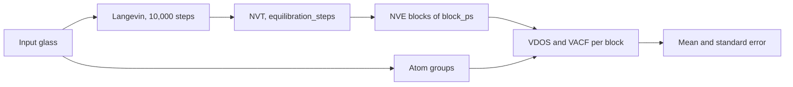

# Vibrational Density of States

The vibrational density of states (VDOS) $g(\nu)$ gives the distribution of vibrational frequencies of a structure.
`vdos_simulation` computes it from the atomic velocities of a microcanonical (NVE) MD run, through the velocity
autocorrelation function (VACF), in total and per atom group (element, oxygen class, $\mathrm{Q}^n$ species). The MD
includes every anharmonic effect of the potential, so the result describes the system at the simulation temperature.
A harmonic route, `harmonic_vdos_simulation`, works from the dynamical matrix of a minimised structure and is
documented separately.

The [VDOS tutorial](../../notebooks/VDOSTutorial.ipynb) runs this route on a 300-atom $\mathrm{SiO_2}$ glass and compares
the result with the silica VDOS of Fossati et al. (2021).

Frequencies are ordinary frequencies in THz (not angular frequencies) throughout.

---

## Theory

This section applies to any VDOS, whichever route produced it.

### Frequency units

`convert_frequency(values, from_unit, to_unit)` converts scalars or arrays between four units, through THz. Negative
values keep their sign.

| Unit | Name in code | Value of 1 THz |
|---|---|---|
| THz | `"THz"` | 1 |
| $\mathrm{cm^{-1}}$ | `"cm-1"` | 33.3564 |
| meV | `"meV"` | 4.13567 |
| rad/ps | `"rad/ps"` | $2\pi$ = 6.28319 |

A frequency corresponds to a temperature $h\nu / k_B$: 1 THz is 48 K.

### Reduced VDOS, boson peak and Debye level

An isotropic elastic continuum with bulk modulus $B$, shear modulus $G$ and mass density $\rho$ has the
longitudinal and transverse sound velocities

$$
v_L = \sqrt{\frac{B + 4G/3}{\rho}}, \quad v_T = \sqrt{\frac{G}{\rho}}.
$$

With the number density $n$, the Debye frequency and temperature are

$$
\nu_D^3 = \frac{9 n}{4 \pi \left(1 / v_L^3 + 2 / v_T^3\right)}, \quad \theta_D = \frac{h \nu_D}{k_B}.
$$

The Debye VDOS $g_D(\nu) = 3 \nu^2 / \nu_D^3$ ($\nu \le \nu_D$, normalised to 1) makes the reduced VDOS
$g(\nu) / \nu^2$ flat at the Debye level $3 / \nu_D^3$, the low-frequency limit for an isotropic solid ($3N$ times
larger for a VDOS that integrates to $3N$). In a glass the reduced VDOS rises above this level at low frequency; the
maximum of that excess is the boson peak (Buchenau et al. 1986).

- `compute_debye_level(structure, bulk_modulus_gpa, shear_modulus_gpa)` takes $B$ and $G$ in GPa and computes $\rho$
  and $n$ from the masses and the cell volume of `structure`. There is no fit of the VDOS: without moduli there is no
  Debye level. Use moduli of the same model and state as the VDOS, e.g. `elastic_simulation(...)["moduli"]["B"]` and
  `["G"]`.
- It also returns the lowest frequency the periodic box supports, $\nu_\mathrm{min} = v_T / L_\mathrm{max}$, the
  transverse acoustic mode whose wavelength is the largest perpendicular cell height. The box has no acoustic modes
  below it.
- `compute_reduced_vdos(frequencies_thz, vdos, peak_range_thz=(0.5, 5.0), debye=None)` returns $g / \nu^2$ (NaN at
  $\nu = 0$) and the boson peak as the raw maximum within `peak_range_thz`, with no smoothing or fit, so pass a
  block-averaged VDOS. A maximum on the first or last bin of the range (`peak_at_range_edge`) means no peak was found
  inside it. With `debye` it also returns the peak height over the Debye level, a `reliable` mask
  ($\nu \ge \nu_\mathrm{min}$) and `peak_below_box_limit`.

### Harmonic thermodynamics

`compute_vibrational_thermodynamics(frequencies_thz, vdos, temperatures_k, lowest_frequency_thz=None)` treats each
mode of frequency $\nu$ as a quantum harmonic oscillator. With $x = h \nu / (k_B T)$ a mode contributes

$$
C_V = k_B \frac{x^2 e^x}{(e^x - 1)^2}, \quad
S = k_B \left[\frac{x}{e^x - 1} - \ln\left(1 - e^{-x}\right)\right],
$$

$$
U = \frac{h \nu}{2} + \frac{h \nu}{e^x - 1}, \quad F = \frac{h \nu}{2} + k_B T \ln\left(1 - e^{-x}\right),
\quad E_\mathrm{ZP} = \frac{h \nu}{2},
$$

and a quantity per atom is $Q(T) = 3 \int g(\nu)\, q(\nu, T)\, d\nu$ (trapezoid rule), for a VDOS normalised to 1.
$C_V$ and $S$ are returned in $k_B$ per atom, $U$, $F$ and $E_\mathrm{ZP}$ in meV per atom. A partial VDOS gives that
group's additive contribution. Grid points with $\nu \le 0$ are left out of the integrals, and
`excluded_weight` reports the share of the VDOS this removes.

At low temperature the result depends on the low-frequency VDOS, which a finite box or a short trajectory does not
resolve. Below $T_\mathrm{min} = h \nu_\mathrm{low} / k_B$ the values are flagged in `reliable`, not removed. Pass
$\nu_\mathrm{low}$ as `lowest_frequency_thz`, e.g. `debye["lowest_box_frequency_thz"]`; without it the first positive
grid frequency is used, which is only the resolution of the grid and gives a too optimistic bound for a small box.

On the VACF route the VDOS comes from classical MD at the simulation temperature, anharmonic effects included, while
the thermodynamics applies quantum oscillator statistics to it.

---

## VACF route

### Theory

#### Velocity autocorrelation function

The mass-weighted, normalised VACF is

$$
C(t_k) = \frac{\sum_i m_i \langle \mathbf{v}_i(0) \cdot \mathbf{v}_i(t_k) \rangle}
{\sum_i m_i \langle |\mathbf{v}_i|^2 \rangle}, \quad t_k = k \Delta t,
$$

where $\langle \cdot \rangle$ averages over all time origins with the unbiased estimator: lag $k$ averages the $N - k$
available products of an $N$-frame trajectory. The total VACF has $C(0) = 1$. `compute_vacf_from_velocities`
computes it with FFTs, zero-padded to $2N$ frames so the correlation does not wrap around, for lags up to
`max_lag_frames` ($N/2$ by default).

#### VDOS as a power spectrum

The VDOS is the mass-weighted power spectrum of the velocities,

$$
g(\nu_k) \propto \sum_i m_i \sum_{\alpha} |V_{i\alpha}(\nu_k)|^2,
\quad V_{i\alpha}(\nu_k) = \sum_{t=0}^{N-1} v_{i\alpha}(t)\, e^{-2\pi \mathrm{i} k t / N},
$$

on the one-sided grid $\nu_k = k / (N \Delta t)$, $k = 0, \dots, \lfloor N/2 \rfloor$. By the Wiener–Khinchin
theorem this equals the Fourier transform of the unnormalised VACF over all lags (Dickey & Paskin 1969); `compute_vdos_from_velocities`
computes the spectrum directly from the velocities, not from the VACF. Normalisation (trapezoid rule):

- `"unit"` (default): the total VDOS integrates to 1, in $\mathrm{THz^{-1}}$.
- `"3N"`: the total integrates to $3N$, the number of degrees of freedom.

The low-level function also accepts `"none"`, the power spectral density in amu (velocity unit)$^2$ ps.

The frequency resolution is $1 / (N \Delta t)$, the length of the trajectory, and the highest frequency is the
Nyquist frequency $1 / (2 \Delta t)$, with $\Delta t$ the time between frames (not the MD timestep).

#### Centre-of-mass removal

The mass-weighted centre-of-mass velocity of the whole system,
$\mathbf{v}_\mathrm{COM}(t) = \sum_i m_i \mathbf{v}_i(t) / \sum_i m_i$, is subtracted from every atom in every frame
before the VDOS and the VACF are computed (`remove_com=True`), also for a partial. Otherwise a drift of the centre of
mass appears at and near zero frequency.

#### Partial VDOS and sum rules

A partial VDOS (or VACF) is the same sum restricted to the atoms of a group, scaled by the normalisation of the
total. Partials over disjoint groups therefore add up to the partial of their union. With the groups of
`classify_vibrational_groups`:

- the element partials add up to the total;
- the oxygen classes (`O_BO`, `O_NBO`, `O_free`, `O_tri`) add up to the oxygen partial;
- the $\mathrm{Q}^n$ groups of a former (e.g. `Si_Q2`, `Si_Q3`, `Si_Q4`) add up to that former's element partial.

A partial integrates to its group's share of the kinetic energy, close to its share of atoms by equipartition. A
partial VACF has $C(0)$ equal to that share.

#### Windows

A window $w_t$ multiplies the centre-of-mass-free velocities of a block before the transform. It suppresses spectral
leakage from the finite trajectory length at the cost of resolution. The effective resolution is
$\mathrm{ENBW} / (N \Delta t)$, with the equivalent noise bandwidth $\mathrm{ENBW} = N \sum_t w_t^2 / (\sum_t w_t)^2$
bins:

| `window` | Form | ENBW (bins) | Effective resolution, 10 ps |
|---|---|---|---|
| `None` | no window | 1 | 0.1 THz, with leakage |
| `"hann"` | $\tfrac{1}{2}\left(1 - \cos(2\pi t / N)\right)$ | 1.5 | 0.15 THz |
| `"hamming"` | $0.54 - 0.46 \cos(2\pi t / N)$ | 1.36 | 0.14 THz |
| `"blackmanharris"` | 4-term Blackman-Harris | 2.0 | 0.20 THz |
| `("gaussian", std)` | Gaussian, $\sigma$ = `std` in frames | $\approx N / (2 \sqrt{\pi} \sigma)$ | 0.23 THz for $\sigma = N/8$ |

`vdos_simulation` returns the VDOS without a window and with `window` (Hann by default). The VACF is never windowed.

---

### Workflow



1. **Langevin** thermalisation at `temperature_sim` for 10,000 steps, with velocities created at `temperature_sim`.
2. **NVT** equilibration with `thermostat` for `equilibration_steps` steps, with velocities created again;
   `equilibration_steps=0` skips it.
3. **NVE production** of `production_ps`, run as `production_ps / block_ps` consecutive blocks, with velocities and
   thermo output every `dump_every` steps. Each block is a new LAMMPS run that starts from the end of the previous
   one.

All stages run at the constant volume of the input cell.

**Why NVE.** The velocities must be the unperturbed time derivatives of the positions. A thermostat rescales or
perturbs them and distorts the spectrum, so the production has no thermostat.

**Step-0 frame.** LAMMPS writes the frame of step 0 of every block, which is the end state of the previous stage or
block. It is dropped, so the kept frames of consecutive blocks do not overlap. Each block holds
`n_frames = block_steps // dump_every` frames spaced by `dt_fs = timestep * dump_every`, and the resolution is
exactly `1 / block_ps` THz. A block whose output does not hold `n_frames + 1` frames raises a `RuntimeError`; no frame
is trimmed silently.

**Atom groups.** `classify_vibrational_groups` labels the atoms of the input structure once, before any MD. The
labels stay fixed for all blocks, so thermal motion of bonds near the cutoff cannot change them. The masses also come
from the input structure.

**Block averaging.** Every returned curve is the mean over blocks, and `vdos_sem` and `vacf_sem` hold the block
standard error `std(ddof=1) / sqrt(n_blocks)` (NaN for one block). Each block is normalised by its own kinetic energy,
so the mean integrates exactly to the normalisation and the mean partials still add up to the mean total. The
standard errors do not add up.

The standard error is the scatter between the blocks of one NVE trajectory of one glass, assumed independent. It
contains no glass-to-glass variation and nothing that stays constant over the run, such as the total energy of the
run. A calibration compared two independent thermal histories of one 300-atom $\mathrm{SiO_2}$ glass (PMMCS, 300 K,
10 blocks of 10 ps), where exact standard errors put 94 % of the bins within two combined standard errors:

| Range | No window | Hann |
|---|---|---|
| 5–34 THz | 93 % | 95 % |
| below 5 THz | 96 % | 98 % |
| 34–40 THz (above the spectrum) | 75 % | 78 % |

Above the spectrum the weight differed by 4 to 5 %, as did the temperature of the two runs. The lag-1 correlation of
the block residuals was close to the $-0.1$ of independent blocks. One pair of runs says nothing about larger boxes,
lower temperatures or shorter blocks.

**Energy drift.** `nve_drift` reports the total energy and temperature over all kept NVE frames. Each block restarts
from the positions and velocities of the previous block's dump, written with 6 significant digits, so the energy can
jump at a block boundary; `boundary_energy_jump_mev_per_atom` measures this restart loss alone. The thermo output has
8 significant digits, i.e. about $|E_\mathrm{tot}| / N \times 10^{-5}$ meV/atom (3.3e-4 meV/atom for $\mathrm{SiO_2}$
with PMMCS at 300 atoms, 1.9e-4 at 5400). In measured runs (300 K, blocks of 2 and 10 ps) every jump was within two
such units, at most 6.7e-4 meV/atom, and smaller than the drift within any block.

**Files.** With `tmp_working_directory=None` every run removes its files. In a caller-supplied directory each NVE
block runs in its own `vdos_nve_block_<block>_<random>` directory, and its `dump.out` is deleted once the spectra and
thermo output are extracted, so at most one dump is on disk at a time. `keep_trajectory=True` keeps every dump.

---

### Usage

#### High-level: `vdos_simulation`

```python
from amorphouspy import vdos_simulation

out = vdos_simulation(
    structure=glass_structure,  # quenched glass, ASE Atoms
    potential=potential_df,  # LAMMPS potential DataFrame
    temperature_sim=300.0,  # K
    timestep=1.0,  # fs
    thermostat="nose_hoover",  # NVT stage (required)
    equilibration_steps=100_000,  # 100 ps of NVT
    production_ps=200.0,  # 20 NVE blocks
    block_ps=10.0,  # resolution 0.1 THz
    dump_every=5,  # 5 fs between frames, Nyquist 100 THz
    window="hann",
    server_kwargs={"cores": 4},
)

freq_thz = out["frequencies_thz"]
g = out["vdos"]["windowed"]["total"]  # 1/THz, integrates to 1
g_sem = out["vdos_sem"]["windowed"]["total"]
g_si = out["vdos"]["windowed"]["element"]["Si"]
g_q4 = out["vdos"]["no_window"]["qn"]["Si_Q4"]
vacf = out["vacf"]["total"]  # on out["lag_ps"]
print(out["n_blocks"], out["resolution_thz"], out["nyquist_thz"])  # 20 0.1 100.0
print(out["nve_drift"]["energy_drift_mev_per_atom_ps"])
```

#### Low-level: VDOS and VACF from a velocity array

The analysis functions take any velocity array of shape `(n_frames, n_atoms, 3)`, the masses in amu and the time
between frames in fs. For velocities from `md_simulation(..., ensemble="nve", n_dump=5)`, use
`result["result"]["velocities"]` (in Å/fs) and drop the frame of step 0. The example uses a synthetic trajectory.

```python
import numpy as np

from amorphouspy import (
    compute_partial_vdos,
    compute_vacf_from_velocities,
    compute_vdos_from_velocities,
    get_atomic_mass,
)

# Synthetic trajectory: one Si and two O atoms oscillating at 10, 20 and 30 THz, 10 ps at 5 fs.
dt_fs, n_frames = 5.0, 2000
t_ps = np.arange(n_frames) * dt_fs * 1e-3
masses = np.array([get_atomic_mass("Si"), get_atomic_mass("O"), get_atomic_mass("O")])
rng = np.random.default_rng(0)
velocities = np.zeros((n_frames, 3, 3))
for atom, nu_thz in enumerate((10.0, 20.0, 30.0)):
    velocities[:, atom, :] = np.cos(2 * np.pi * nu_thz * t_ps[:, None] + rng.uniform(0, 2 * np.pi, 3))

freq_thz, g = compute_vdos_from_velocities(velocities, masses, dt_fs)  # no window
_, g_hann = compute_vdos_from_velocities(velocities, masses, dt_fs, window="hann")
print(freq_thz[1], freq_thz[-1])  # resolution and Nyquist frequency in THz
print(np.trapezoid(g_hann, freq_thz))

# Partials with the layout of classify_vibrational_groups(structure)
groups = {"element": {"Si": np.array([0]), "O": np.array([1, 2])}}
_, partial = compute_partial_vdos(velocities, masses, dt_fs, groups, window="hann")
print(np.abs(partial["element"]["Si"] + partial["element"]["O"] - g_hann).max())

lag_ps, vacf = compute_vacf_from_velocities(velocities, masses, dt_fs)
print(lag_ps[-1], vacf[0])  # half the trajectory in ps, C(0)
```

`compute_partial_vacf` takes the same `groups`. Both partial functions transform every atom once, however many groups
it belongs to.

#### Post-processing: Debye level, boson peak, thermodynamics

Pass `out["frequencies_thz"]` and a total VDOS, e.g. `out["vdos"]["windowed"]["total"]`. The example uses a Debye
VDOS with an excess near 1.2 THz instead.

```python
import numpy as np
from ase import Atoms

from amorphouspy import (
    compute_debye_level,
    compute_reduced_vdos,
    compute_vibrational_thermodynamics,
    convert_frequency,
)

silica = Atoms("Si1000O2000", cell=[35.661] * 3, pbc=True)  # 2.2 g/cm^3; positions are not used
debye = compute_debye_level(silica, bulk_modulus_gpa=36.7, shear_modulus_gpa=31.2)
print(debye["debye_frequency_thz"], debye["lowest_box_frequency_thz"])

freq_thz = np.linspace(0.0, 10.0, 201)
g = freq_thz**2 * (1 + np.exp(-0.5 * ((freq_thz - 1.2) / 0.4) ** 2))
g /= np.trapezoid(g, freq_thz)  # normalised to 1, as normalization="unit"

reduced = compute_reduced_vdos(freq_thz, g, peak_range_thz=(0.5, 5.0), debye=debye)
print(reduced["boson_peak_thz"], reduced["boson_peak_over_debye"], reduced["peak_below_box_limit"])
print(convert_frequency(reduced["boson_peak_thz"], "THz", "meV"))

thermo = compute_vibrational_thermodynamics(
    freq_thz, g, [50.0, 300.0], lowest_frequency_thz=debye["lowest_box_frequency_thz"]
)
print(thermo["heat_capacity_kb_per_atom"], thermo["temperature_bound_k"], thermo["reliable"])
```

---

### Results

**Return keys of `vdos_simulation`:**

| Key | Description |
|---|---|
| `frequencies_thz` | Frequency axis in THz, length `n_frames // 2 + 1`, shared by both VDOS |
| `vdos` | Mean over blocks, `{"no_window": ..., "windowed": ...}` (no `"windowed"` for `window=None`), each `{"total": array, "element": {...}, "oxygen": {...}, "qn": {...}}`, in 1/THz |
| `vdos_sem` | Block standard error of `vdos`, same layout and units; NaN for one block |
| `lag_ps` | VACF lags in ps, length `n_frames // 2 + 1` |
| `vacf` | Mean over blocks, `{"total": array, "element": {...}, "oxygen": {...}, "qn": {...}}`, dimensionless, total $C(0) = 1$ |
| `vacf_sem` | Block standard error of `vacf`, same layout; NaN for one block |
| `groups` | Output of `classify_vibrational_groups` on the input structure (label to 0-based atom positions) |
| `structure` | Final structure of the last NVE block |
| `temperature` | Thermo temperature in K of every kept frame of all blocks, length `n_blocks * n_frames` |
| `energy_tot` | Total energy in eV of every kept frame of all blocks, length `n_blocks * n_frames` |
| `nve_drift` | Energy and temperature drift over all kept NVE frames (see below) |
| `dt_fs` | Time between frames in fs |
| `n_blocks` | Number of NVE blocks |
| `n_frames` | Number of kept frames per block |
| `resolution_thz` | `1 / block_ps` |
| `nyquist_thz` | `1 / (2 dt_fs)` in THz |
| `normalization` | The VDOS normalisation, `"unit"` or `"3N"` |
| `window` | The window of `vdos["windowed"]`, as passed |

**Keys of `nve_drift`** (energies per atom, frame $k$ at $t = (k + 1)\,$`dt_fs`):

| Key | Description |
|---|---|
| `energy_drift_mev_per_atom_ps` | Least-squares slope of $E_\mathrm{tot} / N$ over all blocks, boundary jumps included (meV/atom/ps) |
| `block_energy_drift_mev_per_atom_ps` | The same slope within each block, array of length `n_blocks` |
| `boundary_energy_jump_mev_per_atom` | $E_\mathrm{tot} / N$ of the step-0 frame of block $b + 1$ minus the last kept frame of block $b$, length `n_blocks - 1` (meV/atom) |
| `max_energy_deviation_mev_per_atom` | Largest $\lvert E_\mathrm{tot} - E_\mathrm{tot}[0] \rvert / N$ from the first kept frame (meV/atom) |
| `temperature_mean_k` | Mean temperature (K) |
| `temperature_std_k` | Population standard deviation of the temperature, ddof=0 (K) |
| `temperature_drift_k_per_ps` | Least-squares slope of the temperature (K/ps) |

---

### Parameters

| Parameter | Type | Default | Description |
|---|---|---|---|
| `structure` | `Atoms` | — | Input structure, e.g. a quenched glass; sets the cell, the atom groups and the masses |
| `potential` | `DataFrame` | — | LAMMPS potential |
| `temperature_sim` | `float` | `300.0` | Temperature of the Langevin and NVT stages in K |
| `timestep` | `float` | `1.0` | MD timestep in fs |
| `server_kwargs` | `dict \| None` | `None` | Arguments for the LAMMPS server, e.g. `{"cores": 4}` |
| `thermostat` | `str` | — (required, keyword-only) | NVT thermostat, `"nose_hoover"` or `"langevin"` |
| `equilibration_steps` | `int` | `100_000` | NVT steps; 0 skips the NVT stage |
| `production_ps` | `float` | `200.0` | Total NVE length in ps, a whole number of timesteps and a multiple of `block_ps` |
| `block_ps` | `float` | `10.0` | Length of one NVE block in ps; resolution `1 / block_ps` THz |
| `dump_every` | `int` | `5` | MD steps between frames; must divide the block |
| `normalization` | `str` | `"unit"` | `"unit"` (total integrates to 1) or `"3N"` (to $3N$); the VACF always has $C(0) = 1$ |
| `window` | `str \| tuple \| None` | `"hann"` | Window of the second VDOS: `"hann"`, `"hamming"`, `"blackmanharris"`, `("gaussian", std)` (std in frames), or `None` for the unwindowed VDOS only |
| `cutoff` | `float \| dict \| None` | `None` | Former–O cutoff in Å for the groups; derived from the RDF if `None` |
| `former_types` | `list[int] \| None` | `None` | Atomic numbers of the network formers; derived from the composition if `None` |
| `o_type` | `int` | `8` | Atomic number of oxygen |
| `seed` | `int` | `12345` | Seed for the velocities created in the Langevin and NVT stages |
| `tmp_working_directory` | `str \| Path \| None` | `None` | Directory for simulation files; `None` removes them |
| `keep_trajectory` | `bool` | `False` | Keep the dump of every NVE block; requires `tmp_working_directory` |

All parameters after `server_kwargs` are keyword-only. Invalid values raise a `ValueError` before any MD runs.

---

### Practical considerations

#### Memory and disk

- The velocities of one block take `n_frames * n_atoms * 3 * 8` bytes, e.g. 0.29 GB for 2000 frames (10 ps at
  5 fs) of 6000 atoms. Parsing the LAMMPS output needs much more: a 10 ps block of 5400 atoms peaked 4.5 GB above the
  baseline, 17 times its velocities (measured).
- The peak scales with one block, not with the whole production, because a block's parsed output is freed before the
  next block starts. Not all freed memory returns to the system: over 8 blocks of 2 ps the resident size levelled
  off at 1.7 times the peak of the first block (measured on macOS).
- A dump takes 88 bytes per atom per frame: 0.47 MB per frame and 0.95 GB per 10 ps block at 5400 atoms (measured).
  With `keep_trajectory=True` every block's dump stays, 20 dumps for the defaults.

#### Run length and blocks

- `block_ps` sets the resolution, `1 / block_ps` THz (0.1 THz, i.e. 3.3 $\mathrm{cm^{-1}}$, for 10 ps).
  `production_ps / block_ps` sets the number of blocks and so the standard error. Longer blocks give a finer grid but
  fewer blocks for the same production.
- `production_ps` must be a multiple of `block_ps`, and both a whole number of timesteps; nothing is truncated.
- `equilibration_steps` defaults to 100 ps of NVT. Use a small value only for quick demonstrations.

#### Timestep and dump interval

The Nyquist frequency is $1 / (2\,\mathrm{dt\_fs})$ with `dt_fs = timestep * dump_every`: 100 THz for the defaults
(1 fs, every 5 steps). `vdos_simulation` warns if it is below 50 THz, i.e. if `dt_fs` exceeds 10 fs. The
$\mathrm{SiO_2}$ spectrum ends below 40 THz, well below the default Nyquist frequency.

#### Box size and low frequencies

- The box supports no acoustic mode below $\nu_\mathrm{min} = v_T / L_\mathrm{max}$, reported by
  `compute_debye_level` as `lowest_box_frequency_thz`. For a 3000-atom silica box (35.7 Å) with fused-silica moduli it
  is 1.06 THz.
- The VDOS below $\nu_\mathrm{min}$ does not represent the bulk glass, and neither do thermodynamic values below the
  corresponding temperature (1 THz is 48 K). Pass $\nu_\mathrm{min}$ as `lowest_frequency_thz`.
- The boson peak lies at low frequency (silica peaks near 1 THz), so in small boxes it is limited by
  $\nu_\mathrm{min}$; `compute_reduced_vdos` sets `peak_below_box_limit` when the maximum lies below it. A
  boson-peak statement needs $\nu_\mathrm{min}$ well below the peak, and the same peak in two box sizes is the safest
  evidence. The VDOS tutorial estimates about 50,000 atoms for silica.

#### Atom groups near the cutoff

The groups are classified once, on the input structure. An oxygen whose bond to a former lies near the cutoff gets
the label of that one snapshot for the whole run. Pass `cutoff` and `former_types` explicitly for reproducible groups
across structures, and check the atom count of each group in `out["groups"]`: rare groups such as $\mathrm{Q}^1$
give noisy partials.

#### Temperature from ASE

Structures returned by the LAMMPS runner, including `out["structure"]`, carry velocities in Å/fs, while ASE reads
velocities in its own time unit (about 10.18 fs). `Atoms.get_temperature()` on such a structure is therefore about
104 times too low. Use the `temperature` key, or compute kinetic quantities from the velocities in Å/fs.

---

## References

Dickey, J. M. & Paskin, A. Computer simulation of the lattice dynamics of solids. *Physical Review* **188**,
1407–1418 (1969). <https://doi.org/10.1103/PhysRev.188.1407>

Buchenau, U., Prager, M., Nücker, N., Dianoux, A. J., Ahmad, N. & Phillips, W. A. Low-frequency modes in vitreous
silica. *Physical Review B* **34**, 5665–5673 (1986). <https://doi.org/10.1103/PhysRevB.34.5665>

Fossati, P. C. M., Mellan, T. A., Kuganathan, N. & Lee, W. E. Atomistic modeling approach to the thermodynamics of
sodium silicate glasses. *Journal of the American Ceramic Society* **104**, 1331–1344 (2021).
<https://doi.org/10.1111/jace.17549>
